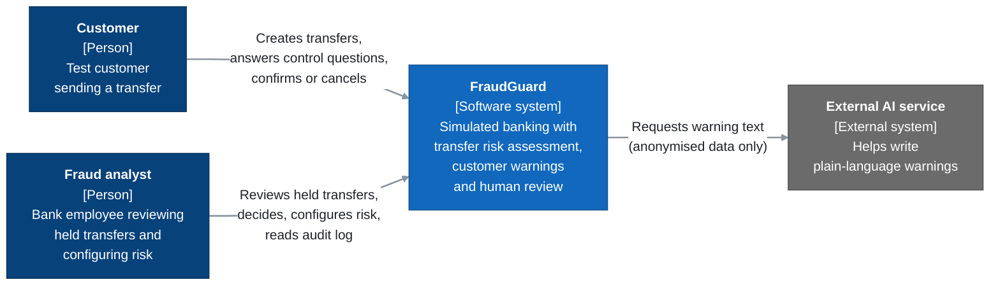
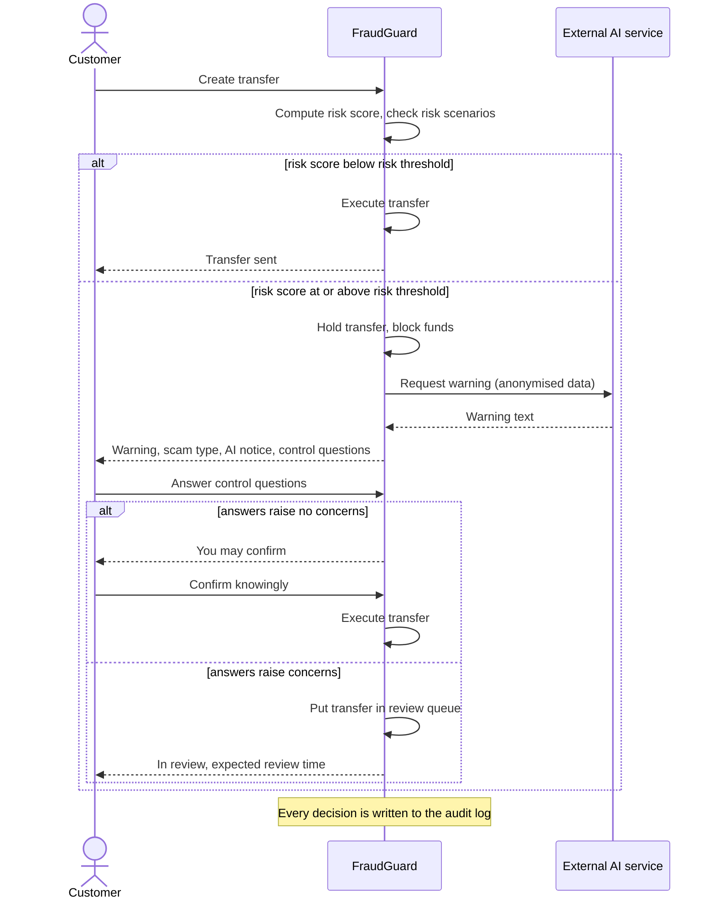
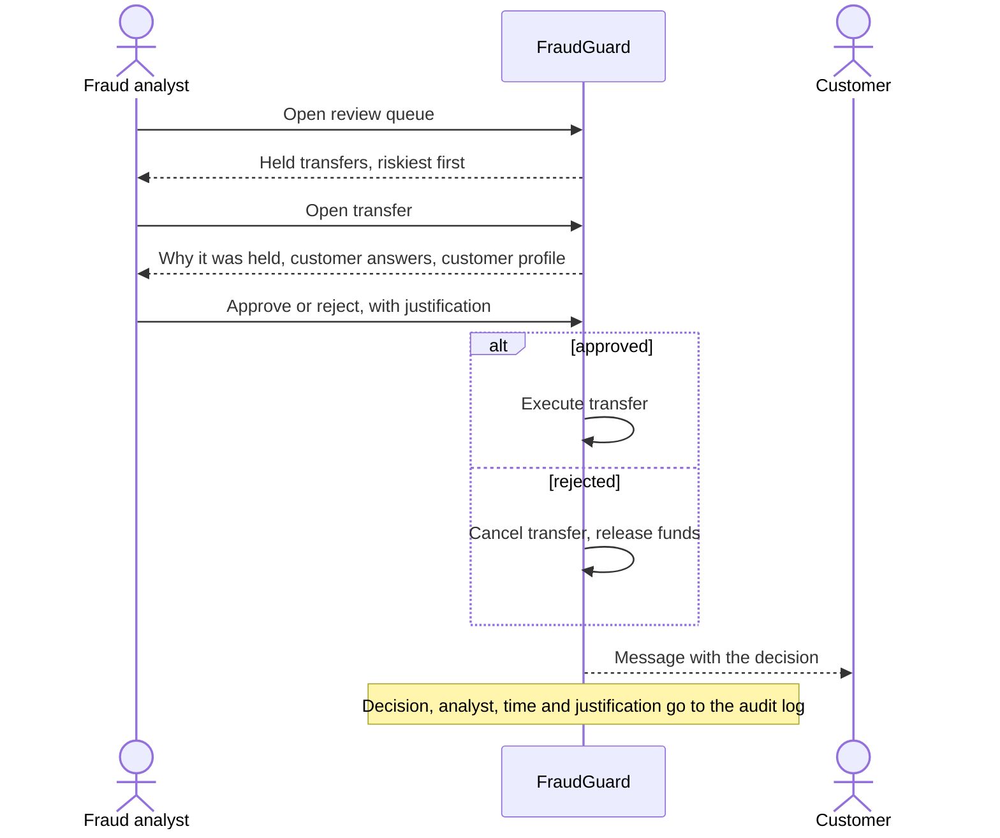
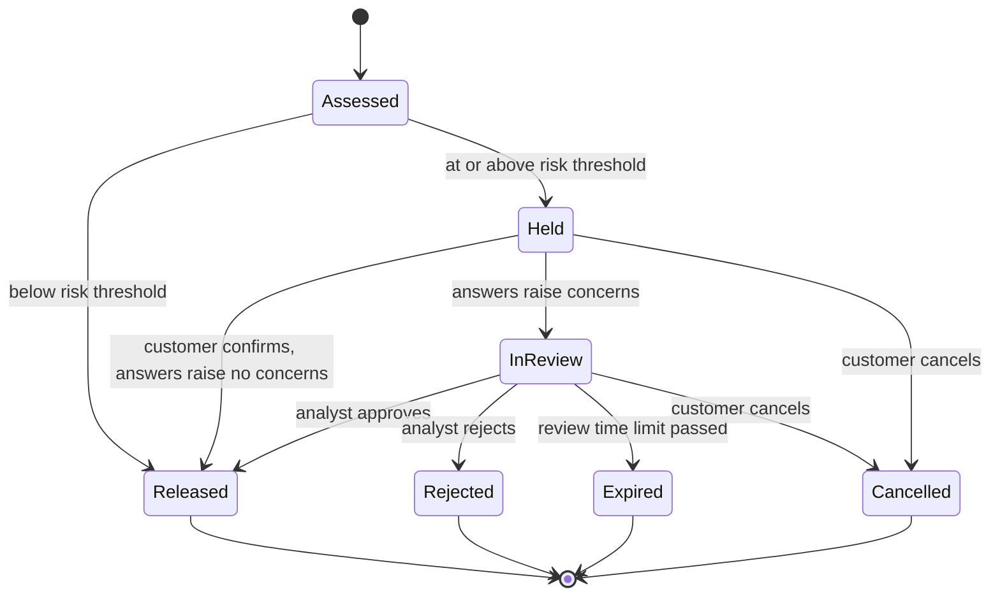

# Architecture: FraudGuard

Last updated: 2026-11-26

> This file describes **how** the system is built. We use the **C4 model**: levels 1 and 2 are mandatory, level 3 only for complex containers, and we don't draw level 4 (code) – the code is the source of truth. Diagrams are written in Mermaid so they can be reviewed in PRs. Names on diagrams = names in the code and in the glossary (`spec.md`, section 7).
>
> **Status:** FraudGuard is a **standalone proof of concept** – it is not integrated with any bank system. The technology stack has not been chosen yet, so this version describes only what does not depend on technology: the system context, the key flows and the cross-cutting rules. Containers, components and deployment will be filled in after the stack decision (`decisions.md`, D-001).

## 1. Overview

| Item | Value |
| --- | --- |
| Stack | [not chosen yet – see `decisions.md`] |
| Hosting | [not chosen yet] |
| Environments | [not defined yet] |
| Repositories | single repo (this one) |

FraudGuard is a self-contained PoC: it simulates the banking side itself (customer accounts, balances, transfer history, transfer execution, users) using test data, and on top of it implements the full fraud flow from the requirements. Low-risk transfers are executed immediately; suspicious ones are held, the customer gets a warning and control questions, and doubtful cases go to a fraud analyst. The only external system is an AI service that helps write the warning – risk assessment and the final decision never depend on it.

## 2. System context (C4 – level 1)

Question: **who and what uses the system, and what does it integrate with?** The system is a single box.

The diagram uses a Mermaid flowchart styled with C4 colours rather than `C4Context`: Mermaid's C4 renderer has a fixed layout that makes relationship labels overlap and gives low-contrast text. The diagram's content still follows C4 level 1.

| Element | Responsibility |
| --- | --- |
| External AI service | turns anonymised risk information into a plain-language warning; optional at runtime – when it fails, FraudGuard uses a simplified (template) warning (NFR-03, NFR-04) |

What FraudGuard simulates instead of bank systems:

| In a real bank | In the PoC |
| --- | --- |
| online / mobile banking | FraudGuard's own customer screens |
| transfer system, account balances | transfers and balances kept and "executed" inside FraudGuard |
| account history | test data loaded at start (seed) |
| customer notifications | messages shown in FraudGuard's customer screens |
| bank identity and access | built-in test users with roles |

Open questions:

- Which AI service will be used?

## 3. Containers (C4 – level 2)

Question: **which runnable parts make up the system, and how do they communicate?** Container = application, service, database, queue.

[To be filled in after the stack decision (`decisions.md`, D-001). Responsibilities that must be covered by some container, from the requirements:]

- simulated banking: test customers, accounts, balances, transfer history, transfer execution
- risk assessment of a transfer and holding / releasing it (F-01)
- warning preparation with AI and with the simplified fallback (F-02, NFR-04)
- control questions and customer confirmation / cancellation (F-03, F-04)
- in-app customer messages about decisions and review time (F-05)
- review queue, review details and analyst decisions (F-06, F-07, F-08)
- enforcing the review time limit – expiring transfers not reviewed in time (F-09)
- configuration of risk scenarios and the risk threshold (F-10)
- append-only audit log (NFR-01)
- anonymisation of data sent to the AI service (NFR-03)

## 4. Components (C4 – level 3, optional)

[Not needed yet. Draw only for a container whose structure is not obvious from the code.]

## 5. Key flows

The flows are described at system level (FraudGuard as one participant), so they don't depend on the stack. Each one points to features in `spec.md`.

### 5.1 Transfer check and customer warning (F-01 – F-05)

Error cases:

- **AI service unavailable or too slow:** FraudGuard shows a simplified (template) warning built from the triggered risk scenarios; the flow continues unchanged (NFR-04).
- **Customer cancels at any point while the transfer is held:** the transfer is cancelled and the funds are released (F-04).

### 5.2 Review by a fraud analyst (F-06 – F-09)

Error cases:

- **Review time limit passes without a decision:** the transfer is not executed; FraudGuard cancels it, releases the funds, records this in the audit log and informs the customer (F-09).
- **Customer cancels during review:** the transfer leaves the queue; an analyst decision made afterwards has no effect (F-04).

### 5.3 Transfer states

## 6. Deployment

[To be filled in after the stack and hosting decision.]

Secrets and configuration (e.g. the AI service key): kept outside the repo; never committed.

## 7. Cross-cutting concepts

Briefly, only what affects many places in the code:

- **Authentication and authorization:** built-in test users. Roles: customer (only own accounts and transfers), fraud analyst (only data needed for a review, risk configuration, read-only audit log) (NFR-05).
- **Audit log:** every decision by the system or an employee is appended with who, when and on what basis (risk score, triggered risk scenarios, customer answers, justification). Entries are never updated or deleted (NFR-01, NFR-02).
- **External AI:** called only with anonymised data and always with a fallback to the simplified warning; a timeout keeps it off the critical path (NFR-03, NFR-04).
- **Risk configuration:** risk scenarios and the risk threshold are data managed in the application, not code; changes are recorded in the audit log (F-10).
- **Test data:** customers, accounts and transfer history are generated test data – never real customer data.
- **Error handling and logging:** [TBD with the stack]; logs never contain identifying data.
- **Monitoring:** [TBD with the stack]; at least the success measures from `spec.md` (false-alarm rate, review time) and AI service availability.
