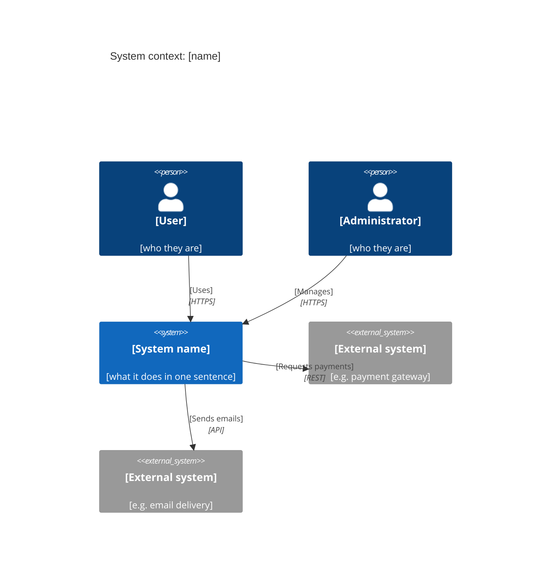
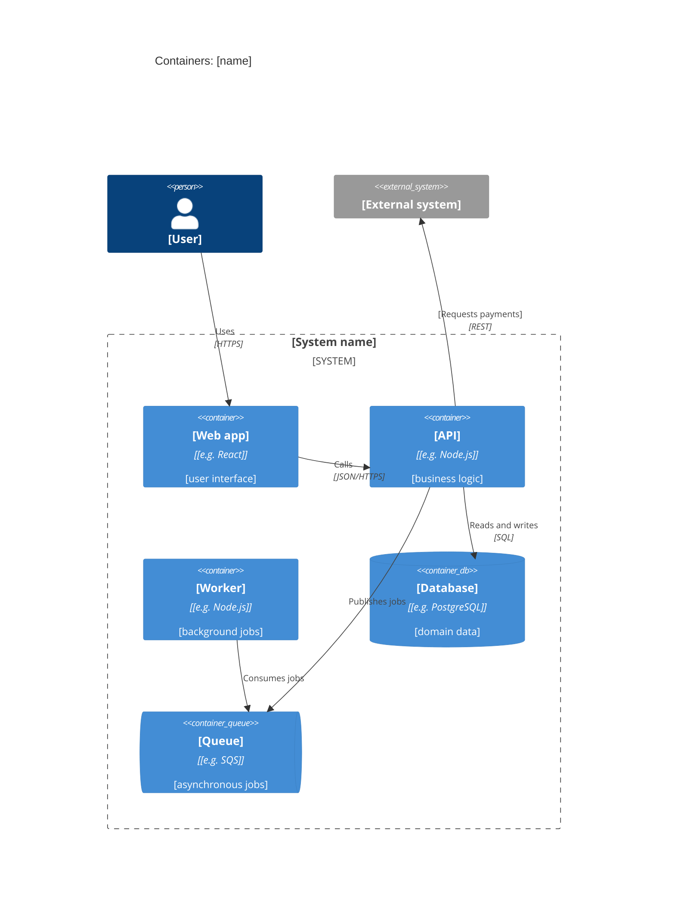
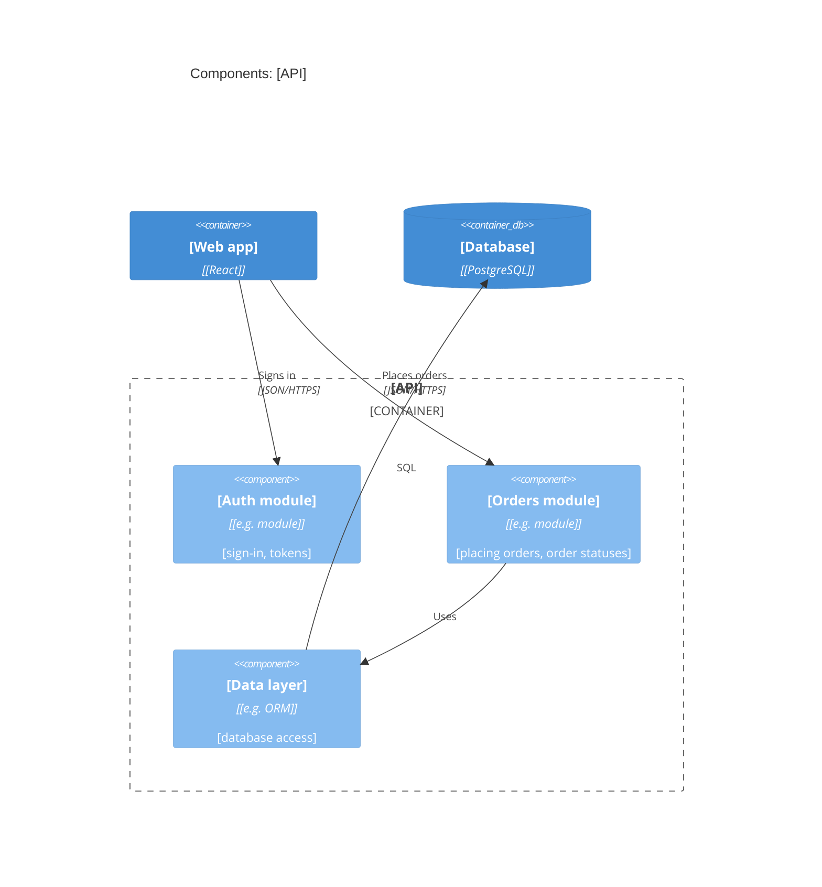
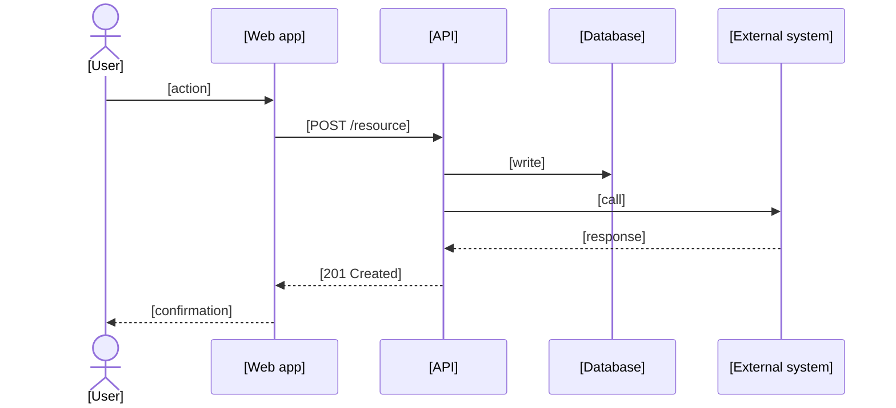

# Architecture: [project name]

Last updated: [YYYY-MM-DD]

> This file describes **how** the system is built. We use the **C4 model**: levels 1 and 2 are mandatory, level 3 only for complex containers, and we don't draw level 4 (code) – the code is the source of truth. Diagrams are written in Mermaid so they can be reviewed in PRs. Names on diagrams = names in the code and in the glossary (`spec.md`, section 7).

## 1. Overview

| Item | Value |
| --- | --- |
| Stack | [language, framework, database] |
| Hosting | [e.g. AWS / Vercel / VPS] |
| Environments | [dev – URL], [staging – URL], [prod – URL] |
| Repositories | [single repo / list] |

[2–3 sentences: the main idea of the solution, e.g. "a modular monolith with a REST API and an SPA; background jobs on a queue". The reasons for important choices are in `decisions.md`.]

## 2. System context (C4 – level 1)

Question: **who and what uses the system, and what does it integrate with?** The system is a single box.

| Element | Responsibility |
| --- | --- |
| [External system] | [what we get from it / what we send to it] |

## 3. Containers (C4 – level 2)

Question: **which runnable parts make up the system, and how do they communicate?** Container = application, service, database, queue.

| Container | Technology | Responsibility | Code |
| --- | --- | --- | --- |
| [API] | [Node.js] | [business logic, authorization] | `[src/api]` |
| [Database] | [PostgreSQL] | [domain data] | `[migrations/]` |

## 4. Components (C4 – level 3, optional)

Draw only for a container whose structure is not obvious from the code. One diagram per container.

## 5. Key flows

A sequence diagram only for the most important or non-obvious scenarios (usually 1–3). Each one points to a feature in `spec.md`.

### 5.1 [Scenario name] (F-0X)

Error cases: [what happens when the external system does not respond / the data is invalid].

## 6. Deployment

| Container | Where it runs | How we deploy |
| --- | --- | --- |
| [Web app] | [e.g. CDN / Vercel] | [automatically from `main`] |
| [API] | [e.g. container on ECS] | [CI pipeline on tag] |
| [Database] | [e.g. RDS] | [migrations in the pipeline] |

Secrets and configuration: [where they are kept, e.g. a secrets manager; never in the repo].

## 7. Cross-cutting concepts

Briefly, only what affects many places in the code:

- **Authentication and authorization:** [e.g. JWT, roles: customer, admin]
- **Error handling and logging:** [e.g. log format, where logs go]
- **Monitoring:** [e.g. metrics, alerts]
- **Personal data:** [what we store, how we protect it, how we delete it]
