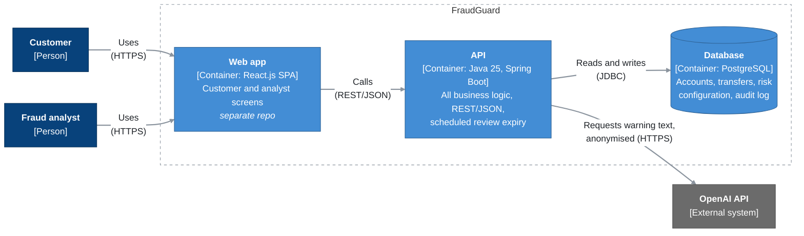
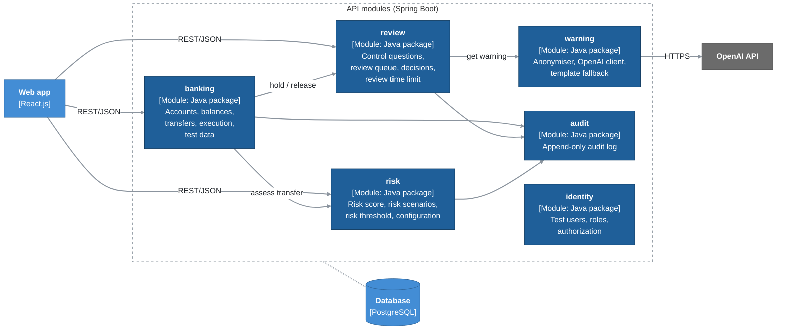
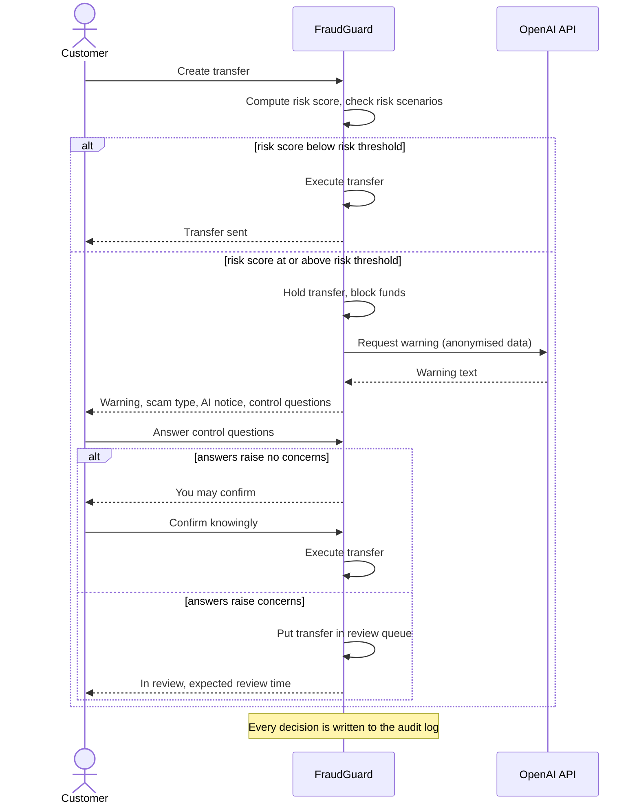
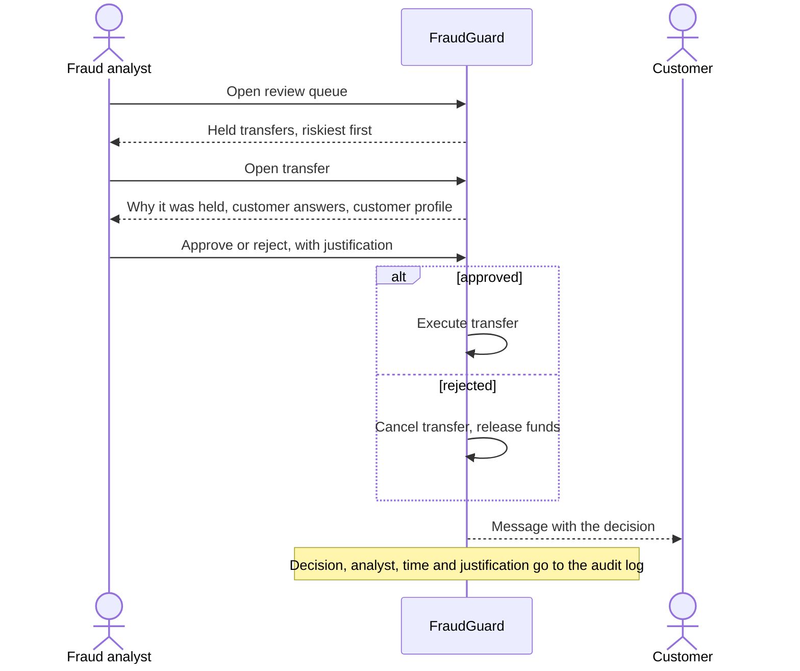
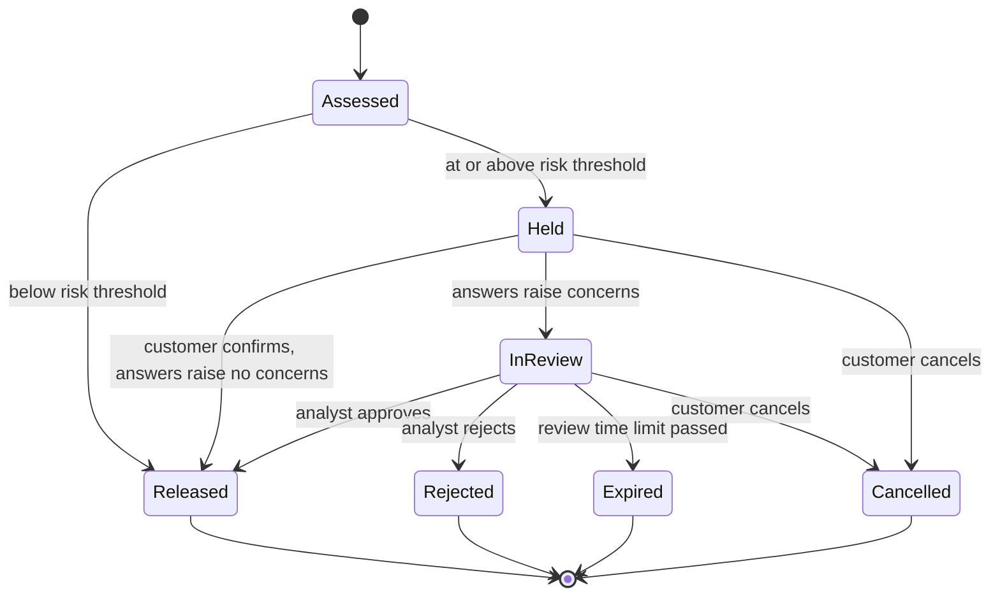

# Architecture: FraudGuard

Last updated: 2026-11-26

> This file describes **how** the system is built. We use the **C4 model**: levels 1 and 2 are mandatory, level 3 only for complex containers, and we don't draw level 4 (code) – the code is the source of truth. Diagrams are written in Mermaid so they can be reviewed in PRs. Names on diagrams = names in the code and in the glossary (`spec.md`, section 7).
>
> **Status:** FraudGuard is a **standalone proof of concept** – it is not integrated with any bank system. The technology stack is chosen in `decisions.md`, D-001. Deployment on AWS will be described after its own decision.

## 1. Overview

| Item | Value |
| --- | --- |
| Stack | backend: Java 25, Spring Boot, Maven; database: PostgreSQL; frontend: React.js; AI: OpenAI API (D-001) |
| Hosting | development: local Docker Compose; finished project: AWS (services to be decided) |
| Environments | local only for now; AWS environments to be defined |
| Repositories | backend (this repo); frontend – separate repo [name / link TBD] |

FraudGuard is a self-contained PoC: it simulates the banking side itself (customer accounts, balances, transfer history, transfer execution, users) using test data, and on top of it implements the full fraud flow from the requirements. Low-risk transfers are executed immediately; suspicious ones are held, the customer gets a warning and control questions, and doubtful cases go to a fraud analyst. The only external system is the OpenAI API, which helps write the warning – risk assessment and the final decision never depend on it.

Technically FraudGuard is a React single-page app (separate repo) talking over REST/JSON to a Spring Boot API, which owns all logic and stores data in PostgreSQL. Reasons for these choices: `decisions.md`, D-001.

## 2. System context (C4 – level 1)

Question: **who and what uses the system, and what does it integrate with?** The system is a single box.

The diagram uses a Mermaid flowchart styled with C4 colours rather than `C4Context`: Mermaid's C4 renderer has a fixed layout that makes relationship labels overlap and gives low-contrast text. The diagram's content still follows C4 level 1.

| Element | Responsibility |
| --- | --- |
| OpenAI API | turns anonymised risk information into a plain-language warning; optional at runtime – when it fails, FraudGuard uses a simplified (template) warning (NFR-03, NFR-04) |

What FraudGuard simulates instead of bank systems:

| In a real bank | In the PoC |
| --- | --- |
| online / mobile banking | FraudGuard's own customer screens |
| transfer system, account balances | transfers and balances kept and "executed" inside FraudGuard |
| account history | test data loaded at start (seed) |
| customer notifications | messages shown in FraudGuard's customer screens |
| bank identity and access | built-in test users with roles |

## 3. Containers (C4 – level 2)

Question: **which runnable parts make up the system, and how do they communicate?** Container = application, service, database, queue.

| Container | Technology | Responsibility | Code |
| --- | --- | --- | --- |
| Web app | React.js (SPA) | customer screens (accounts, transfer, warning, control questions, confirm / cancel, messages) and analyst screens (review queue, review details, decision, risk configuration, audit log); no business logic | separate repo [TBD] |
| API | Java 25, Spring Boot, Maven | all business logic: simulated banking, risk assessment, warnings, review, review time limit (scheduled job), audit log, authorization; REST/JSON contract for the web app | this repo, `src/main/java` |
| Database | PostgreSQL | accounts, balances, transfers and their states, control answers, risk scenarios and threshold, audit log (append-only, protected at database level) | this repo, migrations in `src/main/resources/db/migration` |

The review time limit is enforced by a scheduled job inside the API, not by a separate worker – enough for the PoC.

## 4. Components (C4 – level 3, optional)

The API is the only container with non-obvious structure, so only the API gets a component diagram.

Each box inside the API is a **module**: one Java package per business area, e.g. `…fraudguard.risk`. It is not a separate application or service. All modules are built and deployed together as one Spring Boot application (a modular monolith). Each module has:

- its own classes: REST controllers for the web app, services with business logic, and data access;
- its own database tables;
- a public service that other modules call. A module never reads or writes another module's tables directly.

This keeps business areas separate in the code, so a module could later become a service of its own if needed. The PoC doesn't need that yet.

| Module | Responsibility | Related |
| --- | --- | --- |
| `banking` | simulated accounts, balances and transfer history; creating, executing and cancelling transfers; blocking and releasing funds; loading test data | F-01, F-04 |
| `risk` | computing the risk score and triggered risk scenarios; risk scenarios and threshold as data; their configuration | F-01, F-10 |
| `warning` | removing identifying data, calling OpenAI with a timeout, building the template warning when AI fails, marking the warning as AI-assisted | F-02, NFR-03, NFR-04 |
| `review` | control questions and answers, confirmation, review queue ordered by risk, review details, analyst decisions with justification, expiring transfers after the review time limit, customer messages | F-03, F-05 – F-09 |
| `audit` | appending decision records; read-only access for the analyst | NFR-01, NFR-02 |
| `identity` | test users and roles, access rules for customer and analyst | NFR-05 |

All modules use the database; for readability the diagram shows that as a single dotted line.

## 5. Key flows

The flows are described at system level (FraudGuard as one participant), so they don't depend on the stack. Each one points to features in `spec.md`.

### 5.1 Transfer check and customer warning (F-01 – F-05)

Error cases:

- **OpenAI unavailable or too slow:** FraudGuard shows a simplified (template) warning built from the triggered risk scenarios; the flow continues unchanged (NFR-04).
- **Customer cancels at any point while the transfer is held:** the transfer is cancelled and the funds are released (F-04).

### 5.2 Review by a fraud analyst (F-06 – F-09)

Error cases:

- **Review time limit passes without a decision:** the transfer is not executed; FraudGuard cancels it, releases the funds, records this in the audit log and informs the customer (F-09).
- **Customer cancels during review:** the transfer leaves the queue; an analyst decision made afterwards has no effect (F-04).

### 5.3 Transfer states

## 6. Deployment

### 6.1 Local (development and demo)

| Container | Where it runs | How we start it |
| --- | --- | --- |
| Database | Docker container (PostgreSQL) | `docker compose up` in this repo |
| API | Docker container, or from IntelliJ / `mvn spring-boot:run` during development | `docker compose up` in this repo; migrations run at API start |
| Web app | dev server from the frontend repo, proxying `/api/*` to the API | started in the frontend repo [command TBD] |

Working assumption: the Compose file in this repo starts the database and the API, and the frontend repo starts itself. This keeps the two repos independent. The frontend dev server proxies `/api/*` to the API, so the browser sees one origin and no CORS is needed (D-003). On AWS, one domain serves the SPA at `/` and the API at `/api/*`.

### 6.2 AWS (finished project)

[To be described after a separate decision: AWS services for the web app, API and PostgreSQL, region, infrastructure as code, CI/CD.]

Secrets and configuration (e.g. the OpenAI API key, database password): passed as environment variables, kept outside the repo (locally in an untracked `.env` file, on AWS in a secrets store); never committed.

## 7. Cross-cutting concepts

Briefly, only what affects many places in the code:

- **Authentication and authorization:** built-in test users. Roles: customer (only own accounts and transfers), fraud analyst (only data needed for a review, risk configuration, read-only audit log) (NFR-05). Enforced in the API with Spring Security; the web app only hides what the user can't do. Login creates a server-side session with an `HttpOnly` cookie. State-changing requests carry a CSRF token (`XSRF-TOKEN` cookie, `X-XSRF-TOKEN` header). SPA and API share one origin, so there is no CORS (D-003). The session user is the "who" in the audit log.
- **API contract:** REST/JSON, described with OpenAPI, so the frontend repo can rely on it; changes to the contract are recorded as decisions.
- **Audit log:** every decision by the system or an employee is appended with who, when and on what basis (risk score, triggered risk scenarios, customer answers, justification). Entries are never updated or deleted (NFR-01, NFR-02). In PostgreSQL the application's database user has no `UPDATE` / `DELETE` rights on the audit table.
- **External AI (OpenAI):** called only with anonymised data and always with a fallback to the simplified warning; a timeout keeps it off the critical path (NFR-03, NFR-04). The OpenAI client sits behind our own interface in the `warning` module, so the provider can be swapped and tests can run without OpenAI.
- **Risk configuration:** risk scenarios and the risk threshold are data managed in the application, not code; changes are recorded in the audit log (F-10).
- **Test data:** customers, accounts and transfer history are generated test data – never real customer data.
- **Error handling and logging:** the API returns errors in one JSON format (Spring `ProblemDetail`); logging through SLF4J / Logback to stdout. Logs never contain identifying data.
- **Monitoring:** Spring Boot Actuator (health, metrics). At least the success measures from `spec.md` (false-alarm rate, review time) and OpenAI availability / fallback rate.
